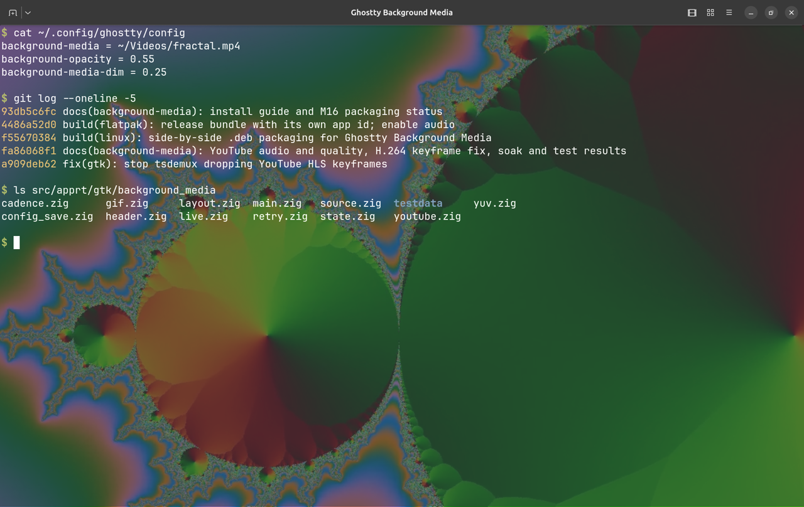

# Ghostty Background Media

Ghostty Background Media is an unofficial Ghostty fork that adds configurable image, GIF, video, and livestream backgrounds to the Linux GTK terminal, with one media decoder shared across tabs and splits. It installs alongside Ghostty as `ghostty-bg-media`.

> This is an unofficial modification of [Ghostty](https://github.com/ghostty-org/ghostty), not affiliated with or endorsed by the Ghostty project.



## Install

Download from the [bgm-v0.1.0-beta pre-release](https://github.com/ltdsword/ghostty-bg-media/releases/tag/bgm-v0.1.0-beta) or browse [all releases](https://github.com/ltdsword/ghostty-bg-media/releases). It installs next to official Ghostty and does not replace it.

| Your system | Package |
| --- | --- |
| Ubuntu 26.04 amd64 | `.deb` |
| Ubuntu 24.04 and other Linux distributions | Flatpak bundle (uses the GNOME 50 runtime from Flathub) |

**Ubuntu 26.04 (`.deb`):**

```sh
wget https://github.com/ltdsword/ghostty-bg-media/releases/download/bgm-v0.1.0-beta/ghostty-bg-media-bgm-v0.1.0-beta-amd64.deb \
     https://github.com/ltdsword/ghostty-bg-media/releases/download/bgm-v0.1.0-beta/SHA256SUMS
sha256sum -c SHA256SUMS --ignore-missing
sudo apt install ./ghostty-bg-media-bgm-v0.1.0-beta-amd64.deb
```

**Ubuntu 24.04 / other distributions (Flatpak):**

```sh
sudo apt install flatpak   # if Flatpak is not installed yet
wget https://github.com/ltdsword/ghostty-bg-media/releases/download/bgm-v0.1.0-beta/ghostty-bg-media-bgm-v0.1.0-beta-x86_64.flatpak
flatpak remote-add --user --if-not-exists flathub https://dl.flathub.org/repo/flathub.flatpakrepo
flatpak install --user ./ghostty-bg-media-bgm-v0.1.0-beta-x86_64.flatpak
```

For YouTube sources, also install `yt-dlp` on the host (`sudo apt install yt-dlp`). Uninstall with
`sudo apt remove ghostty-bg-media` or `flatpak uninstall --user io.github.ltdsword.GhosttyBgMedia`; your config and
media files are kept.

Details: [installation guide](docs/background-media/INSTALL.md) (upgrade, troubleshooting, checksums).

## Quick start

1. Open your config file:
   - `.deb`: `~/.config/ghostty/config` (shared with official Ghostty)
   - Flatpak: `~/.var/app/io.github.ltdsword.GhosttyBgMedia/config/ghostty/config`
2. Add a background and make the terminal background see-through:

   ```conf
   background-media = ~/Pictures/wallpaper.png
   background-opacity = 0.7
   ```

3. Start **Ghostty Background Media** from the app grid, or reload a running window with <kbd>Ctrl</kbd>+<kbd>Shift</kbd>+<kbd>,</kbd>.

Media is drawn behind the terminal and is visible only when `background-opacity` is below `1`.

## Usage

The command is `ghostty-bg-media` for the `.deb` and `flatpak run io.github.ltdsword.GhosttyBgMedia` for the
Flatpak. Both take the same arguments as `ghostty`:

```text
ghostty-bg-media [--<config-key>=<value> ...] [-e <command> [args...]]
ghostty-bg-media +<action> [options]
```

Any config key can be passed as a flag for that launch only, without editing the config file:

```sh
# Video background at 70% terminal opacity
ghostty-bg-media --background-media=~/Videos/ambient.mp4 --background-opacity=0.7

# Livestream, dimmed and slightly blurred
ghostty-bg-media --background-media=https://www.youtube.com/@channel/live \
  --background-media-dim=0.3 --background-media-blur=8 --background-opacity=0.6

# Same with the Flatpak
flatpak run io.github.ltdsword.GhosttyBgMedia --background-media=~/Pictures/loop.gif --background-opacity=0.7

# Run a command in the new window
ghostty-bg-media --background-media=~/Pictures/wallpaper.png --background-opacity=0.7 -e htop
```

Useful actions:

| Command | What it does |
| --- | --- |
| `ghostty-bg-media +version` | Show the version, for example `Ghostty 1.3.2-bgm.0.1.0-beta` |
| `ghostty-bg-media +validate-config` | Check your config file for errors |
| `ghostty-bg-media +show-config --default \| grep background-media` | List the media settings and their defaults |
| `ghostty-bg-media +list-keybinds --default` | List keybindings |

**Control panel:** open **Background Media…** from the window menu, or click the video icon in the header bar.
Change the source, fit, dim, blur, terminal opacity, loop, volume and playback live, then press **Save to
Configuration** to keep them (written to `background-media.ghostty` next to your config). There is no default
keybinding for the panel.

## Configuration

| Key | Default | Values | Effect |
| --- | --- | --- | --- |
| `background-media` | unset | file path or `http(s)://` URL | The media to show; unset = off |
| `background-media-fit` | `cover` | `contain`, `cover`, `stretch`, `none` | How media fills the window |
| `background-media-position` | `center` | `center`, `top-left`, `top-center`, `top-right`, `center-left`, `center-right`, `bottom-left`, `bottom-center`, `bottom-right` | Alignment |
| `background-media-dim` | `0` | `0`–`1` | Darken with the theme background color |
| `background-media-blur` | `0` | `0`–`40` px | Blur the media only; text stays sharp |
| `background-media-loop` | `true` | `true`, `false` | Repeat video and GIF |
| `background-media-volume` | `0` | `0`–`1` | Sound; `0` is muted |
| `background-media-play-in-background` | `false` | `true`, `false` | Keep playing when no Ghostty window is focused |
| `background-media-max-fps` | `30` | `1`–`240` | Redraw cap |
| `background-media-youtube-quality` | `auto` (720p) | `auto` or a height such as `1080` | Preferred YouTube resolution |
| `background-opacity` | `1` | `0`–`1` | Standard Ghostty key; set below `1` to see the media |

Example:

```conf
background-media = ~/Videos/ambient.mp4
background-media-fit = cover
background-media-dim = 0.25
background-media-volume = 0
background-opacity = 0.7
```

Paths may start with `~/`; a leading `?` (for example `?~/Videos/ambient.mp4`) makes a missing file silent.
Changes apply on config reload. The Flatpak can read media only under your home directory.

Details: [configuration reference](docs/background-media/CONFIGURATION.md).

## Features

| Source | Example |
| --- | --- |
| Images: PNG, JPEG, WebP | `~/Pictures/wall.webp` |
| Animated GIF | `~/Pictures/loop.gif` |
| Local video: MP4 (H.264/AAC), WebM, MKV | `~/Videos/ambient.mp4` |
| Direct HTTP(S) video | `https://media.example/video.mp4` |
| HLS, recorded or live | `https://media.example/live.m3u8` |
| YouTube videos and livestreams (needs `yt-dlp`, best effort) | `https://www.youtube.com/watch?v=VIDEO_ID` |

- One media decoder is shared by all tabs and windows; each tab's media spans all its splits.
- Fit, position, dim and media-only blur; terminal text stays sharp on top.
- Loop, volume (muted by default), pause and seek where the source supports it, **Go Live** for streams.
- Pauses when no Ghostty window is focused, unless **Keep playing in background** is on.
- Streams reconnect automatically; upcoming YouTube streams wait until they go live.
- With no media configured, nothing extra runs.

Details: [feature list](docs/background-media/FEATURES.md).

## Status

**bgm-v0.1.0-beta** is a public pre-release (beta).

| Platform | Status |
| --- | --- |
| Ubuntu 26.04 amd64 (`.deb`), GNOME Wayland | Supported; tested on desktop and in a clean container |
| Ubuntu 24.04 and others (Flatpak) | Supported; install and playback tested in a clean Ubuntu 24.04 container, not yet on a real 24.04 desktop |
| X11 apps via XWayland | Tested |
| Native Xorg session | Untested |
| macOS | The inherited background video feature is preserved. This release has no macOS binary; the macOS build and inherited-video smoke test are **UNVERIFIED**. Build from source using the [upstream docs](https://ghostty.org/docs) and [background video notes](BACKGROUND_VIDEO.md). |

Known limits: YouTube depends on `yt-dlp` and can break when YouTube changes; there is no CI yet.

Details: [project status](docs/background-media/STATUS.md) · [changelog](docs/background-media/CHANGELOG.md).

## Credits

[Ghostty](https://github.com/ghostty-org/ghostty) is by Mitchell Hashimoto and Ghostty contributors ([MIT license](LICENSE)). The inherited macOS background video is by [locphamduc96](https://github.com/locphamduc96/ghostty). Linux background media in this fork is by [ltdsword](https://github.com/ltdsword/ghostty-bg-media).

## Documentation

[Install](docs/background-media/INSTALL.md) · [Configuration](docs/background-media/CONFIGURATION.md) · [Features](docs/background-media/FEATURES.md) · [Changelog](docs/background-media/CHANGELOG.md) · [Status](docs/background-media/STATUS.md)

---

<!-- LOGO -->
<h1>
<p align="center">
  
  <br>Ghostty
</h1>
  <p align="center">
    Fast, native, feature-rich terminal emulator pushing modern features.
    <br />
    A native GUI or embeddable library via <code>libghostty</code>.
    <br />
    <a href="#about">About</a>
    ·
    <a href="https://ghostty.org/download">Download</a>
    ·
    <a href="https://ghostty.org/docs">Documentation</a>
    ·
    <a href="CONTRIBUTING.md">Contributing</a>
    ·
    <a href="HACKING.md">Developing</a>
  </p>
</p>

## About

Ghostty is a terminal emulator that differentiates itself by being
fast, feature-rich, and native. While there are many excellent terminal
emulators available, they all force you to choose between speed,
features, or native UIs. Ghostty provides all three.

**`libghostty`** is a cross-platform, zero-dependency C and Zig library
for building terminal emulators or utilizing terminal functionality
(such as style parsing). Anyone can use `libghostty` to build a terminal
emulator or embed a terminal into their own applications. See
[Ghostling](https://github.com/ghostty-org/ghostling) for a minimal complete project
example or the [`examples` directory](https://github.com/ghostty-org/ghostty/tree/main/example)
for smaller examples of using `libghostty` in C and Zig.

For more details, see [About Ghostty](https://ghostty.org/docs/about).

## Download

See the [download page](https://ghostty.org/download) on the Ghostty website.

## Documentation

See the [documentation](https://ghostty.org/docs) on the Ghostty website.

## Contributing and Developing

If you have any ideas, issues, etc. regarding Ghostty, or would like to
contribute to Ghostty through pull requests, please check out our
["Contributing to Ghostty"](CONTRIBUTING.md) document. Those who would like
to get involved with Ghostty's development as well should also read the
["Developing Ghostty"](HACKING.md) document for more technical details.

## Roadmap and Status

Ghostty is stable and in use by millions of people and machines daily.

The high-level ambitious plan for the project, in order:

|  #  | Step                                                    | Status |
| :-: | ------------------------------------------------------- | :----: |
|  1  | Standards-compliant terminal emulation                  |   ✅   |
|  2  | Competitive performance                                 |   ✅   |
|  3  | Rich windowing features -- multi-window, tabbing, panes |   ✅   |
|  4  | Native Platform Experiences                             |   ✅   |
|  5  | Cross-platform `libghostty` for Embeddable Terminals    |   ✅   |
|  6  | Ghostty-only Terminal Control Sequences                 |   ❌   |

Additional details for each step in the big roadmap below:

#### Standards-Compliant Terminal Emulation

Ghostty implements all of the regularly used control sequences and
can run every mainstream terminal program without issue. For legacy sequences,
we've done a [comprehensive xterm audit](https://github.com/ghostty-org/ghostty/issues/632)
comparing Ghostty's behavior to xterm and building a set of conformance
test cases.

In addition to legacy sequences (what you'd call real "terminal" emulation),
Ghostty also supports more modern sequences than almost any other terminal
emulator. These features include things like the Kitty graphics protocol,
Kitty image protocol, clipboard sequences, synchronized rendering,
light/dark mode notifications, and many, many more.

We believe Ghostty is one of the most compliant and feature-rich terminal
emulators available.

Terminal behavior is partially a de jure standard
(i.e. [ECMA-48](https://ecma-international.org/publications-and-standards/standards/ecma-48/))
but mostly a de facto standard as defined by popular terminal emulators
worldwide. Ghostty takes the approach that our behavior is defined by
(1) standards, if available, (2) xterm, if the feature exists, (3)
other popular terminals, in that order. This defines what the Ghostty project
views as a "standard."

#### Competitive Performance

Ghostty is generally in the same performance category as the other highest
performing terminal emulators.

"The same performance category" means that Ghostty is much faster than
traditional or "slow" terminals and is within an unnoticeable margin of the
well-known "fast" terminals. For example, Ghostty and Alacritty are usually within
a few percentage points of each other on various benchmarks, but are both
something like 100x faster than Terminal.app and iTerm. However, Ghostty
is much more feature rich than Alacritty and has a much more native app
experience.

This performance is achieved through high-level architectural decisions and
low-level optimizations. At a high-level, Ghostty has a multi-threaded
architecture with a dedicated read thread, write thread, and render thread
per terminal. Our renderer uses OpenGL on Linux and Metal on macOS.
Our read thread has a heavily optimized terminal parser that leverages
CPU-specific SIMD instructions. Etc.

#### Rich Windowing Features

The Mac and Linux (build with GTK) apps support multi-window, tabbing, and
splits with additional features such as tab renaming, coloring, etc. These
features allow for a higher degree of organization and customization than
single-window terminals.

#### Native Platform Experiences

Ghostty is a cross-platform terminal emulator but we don't aim for a
least-common-denominator experience. There is a large, shared core written
in Zig but we do a lot of platform-native things:

- The macOS app is a true SwiftUI-based application with all the things you
  would expect such as real windowing, menu bars, a settings GUI, etc.
- macOS uses a true Metal renderer with CoreText for font discovery.
- macOS supports AppleScript, Apple Shortcuts (AppIntents), etc.
- The Linux app is built with GTK.
- The Linux app integrates deeply with systemd if available for things
  like always-on, new windows in a single instance, cgroup isolation, etc.

Our goal with Ghostty is for users of whatever platform they run Ghostty
on to think that Ghostty was built for their platform first and maybe even
exclusively. We want Ghostty to feel like a native app on every platform,
for the best definition of "native" on each platform.

#### Cross-platform `libghostty` for Embeddable Terminals

In addition to being a standalone terminal emulator, Ghostty is a
C-compatible library for embedding a fast, feature-rich terminal emulator
in any 3rd party project. This library is called `libghostty`.

Due to the scope of this project, we're breaking libghostty down into
separate libraries, starting with `libghostty-vt`. The goal of
this project is to focus on parsing terminal sequences and maintaining
terminal state. This is covered in more detail in this
[blog post](https://mitchellh.com/writing/libghostty-is-coming).

`libghostty-vt` is already available and usable today for Zig and C and
is compatible for macOS, Linux, Windows, and WebAssembly. The functionality
is extremely stable (since its been proven in Ghostty GUI for a long time),
but the API signatures are still in flux.

`libghostty` is already heavily in use. See [`examples`](https://github.com/ghostty-org/ghostty/tree/main/example)
for small examples of using `libghostty` in C and Zig or the
[Ghostling](https://github.com/ghostty-org/ghostling) project for a
complete example. See [awesome-libghostty](https://github.com/Uzaaft/awesome-libghostty)
for a list of projects and resources related to `libghostty`.

We haven't tagged libghostty with a version yet and we're still working
on a better docs experience, but our [Doxygen website](https://libghostty.tip.ghostty.org/)
is a good resource for the C API.

#### Ghostty-only Terminal Control Sequences

We want and believe that terminal applications can and should be able
to do so much more. We've worked hard to support a wide variety of modern
sequences created by other terminal emulators towards this end, but we also
want to fill the gaps by creating our own sequences.

We've been hesitant to do this up until now because we don't want to create
more fragmentation in the terminal ecosystem by creating sequences that only
work in Ghostty. But, we do want to balance that with the desire to push the
terminal forward with stagnant standards and the slow pace of change in the
terminal ecosystem.

We haven't done any of this yet.

## Crash Reports

Ghostty has a built-in crash reporter that will generate and save crash
reports to disk. The crash reports are saved to the `$XDG_STATE_HOME/ghostty/crash`
directory. If `$XDG_STATE_HOME` is not set, the default is `~/.local/state`.
**Crash reports are _not_ automatically sent anywhere off your machine.**

Crash reports are only generated the next time Ghostty is started after a
crash. If Ghostty crashes and you want to generate a crash report, you must
restart Ghostty at least once. You should see a message in the log that a
crash report was generated.

> [!NOTE]
>
> Use the `ghostty +crash-report` CLI command to get a list of available crash
> reports. A future version of Ghostty will make the contents of the crash
> reports more easily viewable through the CLI and GUI.

Crash reports end in the `.ghosttycrash` extension. The crash reports are in
[Sentry envelope format](https://develop.sentry.dev/sdk/envelopes/). You can
upload these to your own Sentry account to view their contents, but the format
is also publicly documented so any other available tools can also be used.
The `ghostty +crash-report` CLI command can be used to list any crash reports.
A future version of Ghostty will show you the contents of the crash report
directly in the terminal.

To send the crash report to the Ghostty project, you can use the following
CLI command using the [Sentry CLI](https://docs.sentry.io/cli/installation/):

```shell-session
SENTRY_DSN=https://e914ee84fd895c4fe324afa3e53dac76@o4507352570920960.ingest.us.sentry.io/4507850923638784 sentry-cli send-envelope --raw <path to ghostty crash>
```

> [!WARNING]
>
> The crash report can contain sensitive information. The report doesn't
> purposely contain sensitive information, but it does contain the full
> stack memory of each thread at the time of the crash. This information
> is used to rebuild the stack trace but can also contain sensitive data
> depending on when the crash occurred.
